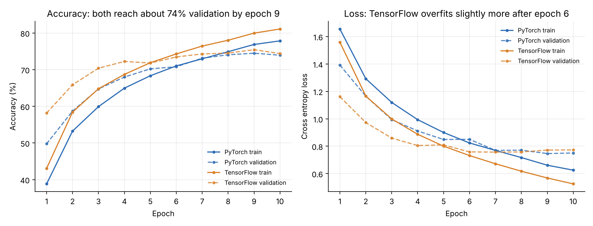

# Comparative Study of PyTorch and TensorFlow (Keras) – CIFAR-10 Image Classification

Deep Learning CCA2 · BMS Institute of Technology & Management · Department of CSBS

| Student | USN | Framework |
| --- | --- | --- |
| R Deepak Reddy | 1BY23CB042 | PyTorch |
| Umashankar S | 1BY23CB058 | TensorFlow (Keras) |

The same CNN (3 conv blocks + dense head, 356,810 parameters) is trained on CIFAR-10 in both frameworks with identical
data split (45,000 / 5,000 / 10,000), optimizer (Adam, lr 0.001), batch size 64 and 10 epochs, on a Google Colab T4 GPU.

## Results

| Metric | PyTorch 2.14.1 | TensorFlow 2.21.0 / Keras 3.13.2 |
| --- | --- | --- |
| Test accuracy | 72.79% | 72.71% |
| Total training time | 37.1 s | 58.0 s |
| Time per epoch (after epoch 1) | ~3.0 s | ~3.6 s |
| Inference, 10,000 images | 0.10 s | 1.05 s |
| Peak GPU memory (framework-reported) | 214 MB | 761 MB |
| Lines of code (model + training + evaluation) | 34 | 15 |

## Contents

- `notebooks/CCA2_PyTorch_CIFAR10.ipynb` – PyTorch implementation
- `notebooks/CCA2_TensorFlow_CIFAR10.ipynb` – TensorFlow / Keras implementation
- `results/` – raw results from each run (history for every epoch, timings, test predictions)
- `figures/` – training output screenshots and comparison plots

## How to run

Open a notebook in Google Colab, choose **Runtime → Change runtime type → T4 GPU**, then **Runtime → Run all**.
Each run takes about 5 to 15 minutes and downloads a `results_*.json` file at the end.
